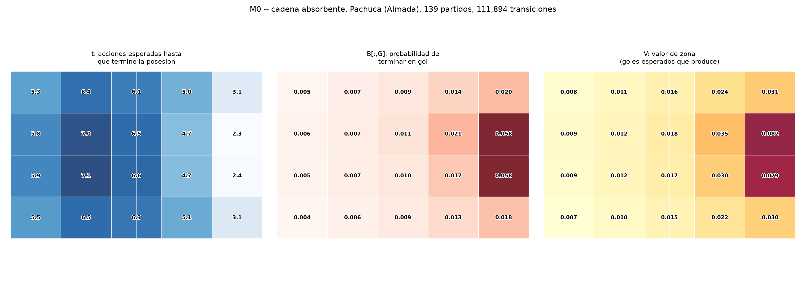
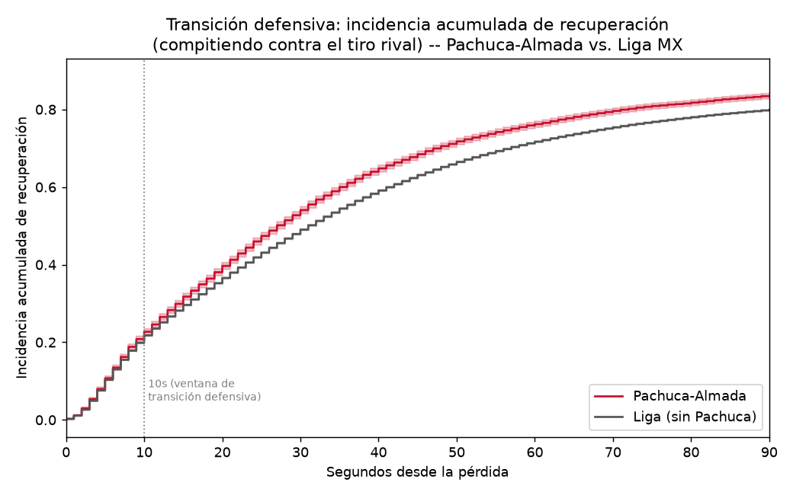
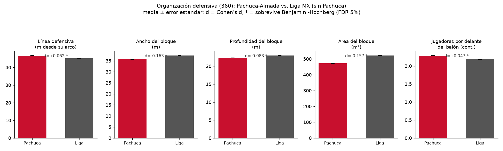
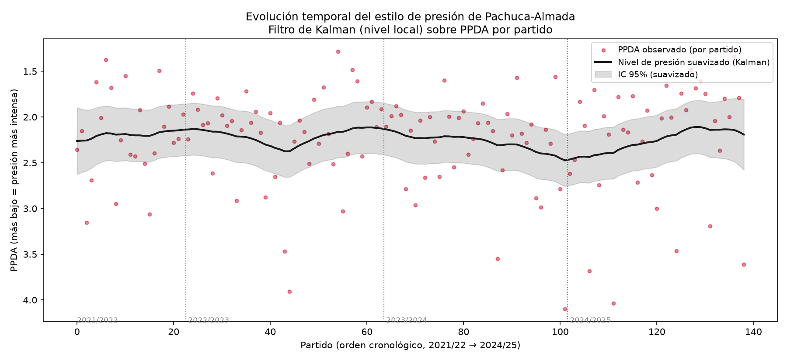
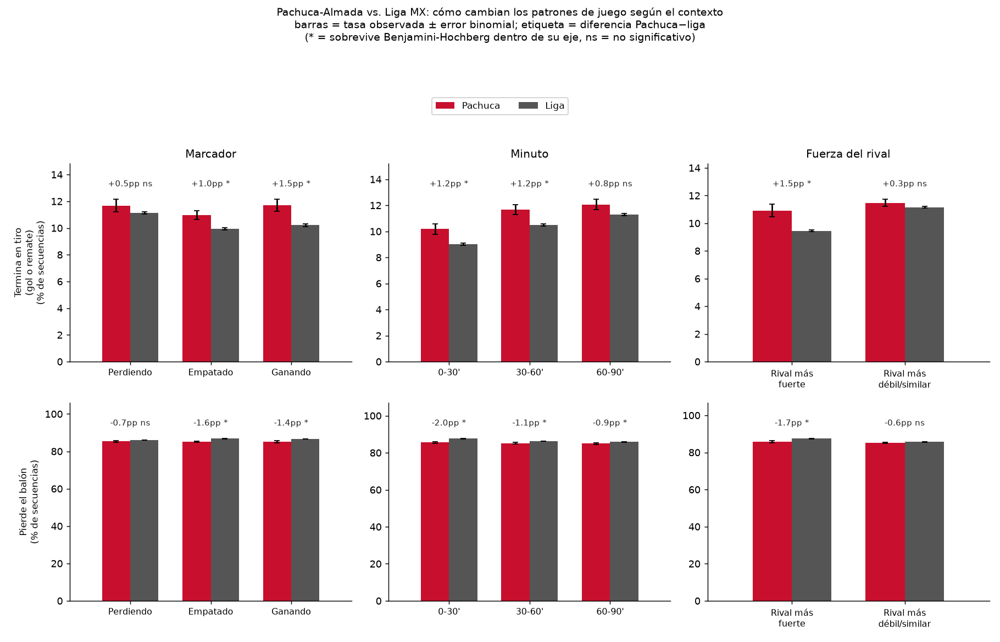
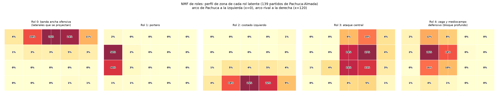
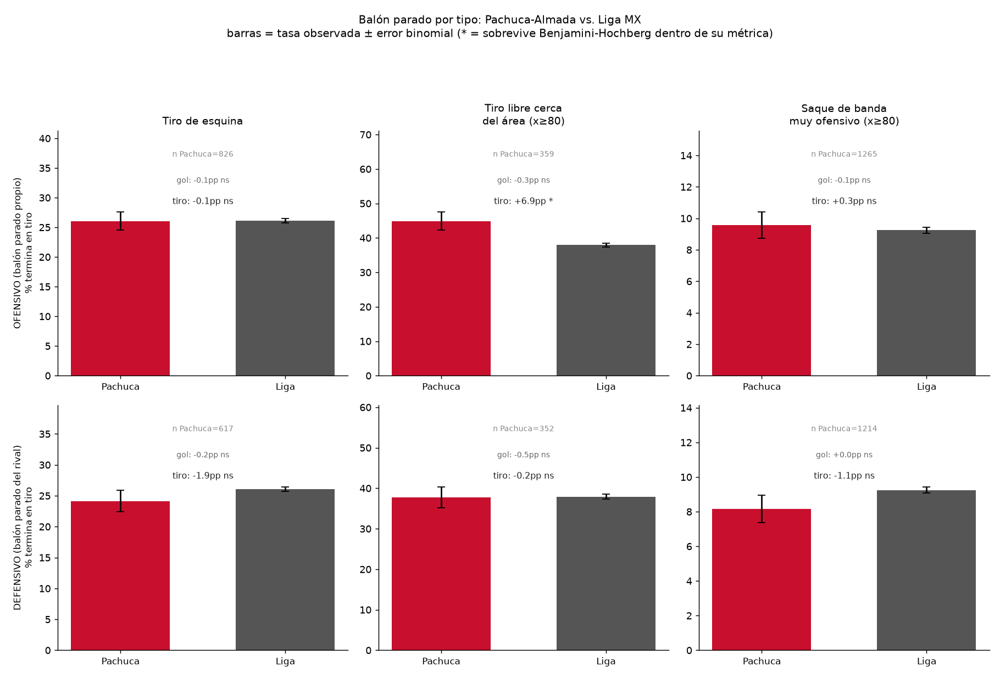
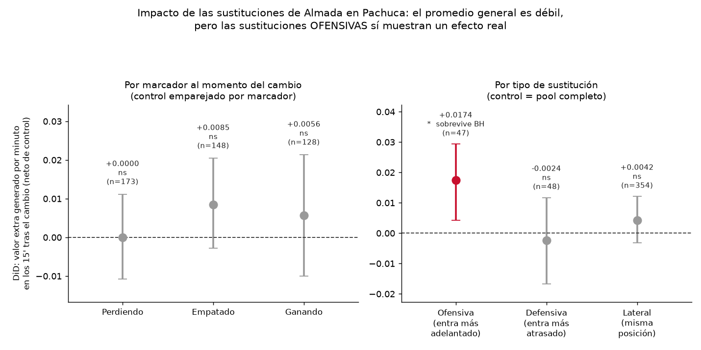

# La historia de un entrenador a través de los datos: Guillermo Almada en Pachuca

*Hackathon ISAC 2026 — Reto Oficial Club América. Datos: StatsBomb (eventos + 360), Liga MX, uso exclusivo de esta competencia.*

## Resumen ejecutivo

Este informe describe el estilo futbolístico de **Guillermo Almada al frente de Pachuca** (139 partidos de fase regular, 2021/22–2024/25), usando exclusivamente datos StatsBomb (eventos + 360). No es una comparación causal de técnicos ni una afirmación generalizable sobre "todos los DTs de la liga" — es un perfil descriptivo de un caso de estudio concreto, con incertidumbre honesta en cada número.

La conclusión central, sostenida por **seis piezas de evidencia construidas con métodos y supuestos distintos entre sí** (no son estadísticamente independientes en sentido estricto — vienen de los mismos 139 partidos — pero sí son *convergentes*: ninguna se apoya en la otra para llegar a su conclusión) que apuntan en la misma dirección, es que **Almada monta un Pachuca que presiona más arriba, más compacto y recupera el balón más rápido que el equipo promedio de Liga MX**, con laterales que se proyectan sistemáticamente al ataque para sostener ese bloque, un estilo que se mantiene **estable durante sus cuatro temporadas** (no es una fase transitoria), y con reacciones al marcador que amplifican — no diluyen — su idea de juego cuando va ganando.

Todo el trabajo sigue una única familia de modelos anidados (cadena de Markov absorbente → +contexto → +memoria), documentada paso a paso en [`FRAMEWORK.md`](FRAMEWORK.md), donde cada extensión del modelo solo se acepta si predice mejor en partidos que no vio.

**Nota de corrección (2026-09-24):** esta versión incorpora una corrección metodológica encontrada por una auditoría cruzada de otro equipo trabajando el mismo reto. Se verificó cada crítica contra nuestros propios datos antes de aceptarla (dos resultaron reales, documentadas en detalle en `FRAMEWORK.md`): la unidad de análisis de la cadena de Markov estaba mal definida (una posesión de StatsBomb puede contener más de una absorción — ~10% de los casos — y el código no las cortaba), y el test de significancia de M1 usaba una nula por bootstrap inválida (producía valores imposibles, $G^2<0$). Ambas se corrigieron y todo el pipeline se recalculó. El efecto fue mixto, como debe ser en una corrección honesta: algunos hallazgos se debilitaron (el efecto δ de M1), otros se fortalecieron (balón parado ofensivo), y el hallazgo central del informe no cambió.

**Nota de alcance:** este informe describe *estilo*, no *efectividad* — no conecta estos patrones con puntos, posición en tabla o goles a favor/en contra; esa es una pregunta distinta y deliberadamente fuera de este análisis.

### Resumen por punto del rubro

| Rubro | Hallazgo en una línea | Fuerza de la evidencia |
|---|---|---|
| 5.1 Estilo de juego (defensivo) | Presiona más alto, más compacto, recupera más rápido — 5 métodos convergentes | Alta |
| 5.1 Estilo de juego (ofensivo) | Amplifica conversión a gol al ir ganando; efecto δ positivo pero pequeño fuera de muestra | Media |
| 5.2 Consistencia y variabilidad | Estable ante el marcador dentro del partido y entre las 4 temporadas | Alta |
| 5.3 Uso de jugadores | Laterales con rol de banda ancha ofensiva (validado contra posición real) | Media-alta |
| 5.4 Balón parado (defensivo) | Rival remata menos desde balón parado contra Pachuca | Media-alta |
| 5.4 Balón parado (ofensivo) | Convierte más a tiro que la liga desde su propio balón parado | Media-alta |
| 5.5 Evidencia cuantitativa | Bootstrap, pruebas de hipótesis, validación fuera de muestra — incluye una autocorrección documentada | Alta (transversal) |
| 5.6 Framework analítico | Familia de modelos anidados M0⊂M1⊂M2, documentada en FRAMEWORK.md | Alta |
| Extra: DiD de sustituciones | Promedio general débil, pero sustituciones ofensivas (entra alguien más adelantado) sí generan valor extra real | Media (desglose, n=47) — débil (promedio general) |

### Glosario rápido

*(para lectores sin formación previa en analítica de fútbol o en los términos estadísticos usados)*

- **360 (StatsBomb)**: datos de posición de *todos* los jugadores en cancha en momentos clave, no solo de quien tiene el balón.
- **xG (expected goals / goles esperados)**: probabilidad estimada de que un tiro concreto termine en gol, según su distancia, ángulo y otras características.
- **Elo**: sistema de calificación de fuerza relativa de un equipo (el mismo tipo de escala que se usa en ajedrez), aquí usado como una medida de qué tan fuerte es el rival en cada partido.
- **PPDA**: pases que se le permiten al rival antes de hacerle una acción defensiva (presión, entrada, intercepción, falta) — *más bajo* significa presión *más intensa* (se le corta antes al rival).
- **NMF (factorización de matrices no negativas)**: técnica que, dada una tabla de "cuánto toca el balón cada jugador en cada zona", encuentra un puñado de patrones-tipo (roles) que explican esa tabla, sin que nadie le diga de antemano qué buscar.
- **Filtro de Kalman**: método que separa, en una serie de mediciones ruidosas en el tiempo, cuánto del cambio observado es una tendencia real y cuánto es simple ruido de un partido a otro.
- **Bootstrap**: técnica de remuestrear los datos muchas veces (aquí, por partido completo) para estimar qué tan seguro se puede estar de un número, sin asumir una fórmula matemática rígida para el error.
- **Kaplan-Meier / log-rank**: herramientas de "análisis de supervivencia" (originalmente de medicina, para tiempos hasta un evento) usadas aquí para el tiempo que tarda un equipo en recuperar el balón.
- **Casco convexo**: la figura geométrica más pequeña que envuelve un grupo de puntos (aquí, las posiciones de los jugadores) — su área mide qué tan compacto o disperso está el equipo.
- **AUC**: qué tan bien un modelo distingue entre los casos positivos y negativos (aquí, tiros que sí terminan en gol vs. los que no); 0.5 es azar puro, 1.0 es perfecto.
- **Encogimiento (shrinkage)**: técnica que "jala" una estimación con poca muestra hacia el promedio de un grupo más grande, para no sobre-confiar en zonas con pocos datos.
- **HMM (modelo oculto de Markov)**: modelo que asume la existencia de "modos de juego" no observados directamente, que se infieren a partir del comportamiento visible.

---

## 1. Caso de estudio y alcance

Almada dirigió Pachuca en 139 partidos de fase regular con cobertura 360 al 100% (también dirigió Santos Laguna y América en la ventana de datos, pero este informe se enfoca en Pachuca, su etapa más larga). Se excluyen tiempo extra y tandas de penales — no encajan en el marco de partido regular que usa el modelo. Todo lo que se reporta para Pachuca se compara contra **la Liga MX del mismo periodo, excluyendo a Pachuca**, para no diluir la comparación contra su propio promedio.

Antes de construir cualquier modelo, este proyecto pasó por una exploración inicial que probó **cuatro métodos independientes** buscando una "huella de DT" generalizable a nivel liga (embeddings, modelos jerárquicos, un modelo de secuencia neuronal, y una prueba de permutación) — ninguno encontró señal distinguible de la identidad del equipo. Esa es la razón por la que este informe no intenta esa pregunta más amplia: se enfoca en describir, con rigor, un caso concreto y delimitado.

## 2. Framework analítico

Familia de modelos anidados, cada escalón validado antes de aceptarse:

- **M0 — cadena de Markov absorbente**: el campo se discretiza en una malla de 5×4=20 zonas; cada posesión es una secuencia de zonas que termina en uno de cuatro estados absorbentes — **G** (gol), **R** (remate sin gol), **P** (pérdida), **D** (detención). De la matriz de transición se derivan $t$ (acciones esperadas hasta terminar), $B$ (probabilidad de cada resultado) y $V$ (valor esperado de gol de cada zona).
- **M1 — +contexto**: regresión logística multinomial que agrega marcador, minuto, local/visitante y fuerza relativa del rival (Elo), separando el efecto de liga ($\beta$) del efecto específico de Pachuca ($\delta$) en un solo ajuste.
- **M2 — +memoria**: se agregan features de historia dentro de la posesión (acciones acumuladas, tipo de acción previa, presión, si nace de una recuperación) — pero *solo* porque una prueba de bondad de ajuste mostró que M0 no explica bien la duración real de las posesiones. Se adoptó porque mejoró la predicción en partidos que el modelo no vio en entrenamiento, no solo el ajuste interno.

El documento completo de supuestos, definiciones y bitácora de decisiones está en [`FRAMEWORK.md`](FRAMEWORK.md).

## 3. Estilo de juego (reto 5.1)

### 3.1 Ofensivo

Sobre 111,894 transiciones de Pachuca-Almada (19,768 secuencias — ver nota metodológica abajo), el valor esperado de gol por zona ($V$) crece de forma consistente con la cercanía al arco rival (las zonas del área rival valen ~9-10× las propias), en línea con los modelos de *expected threat* publicados en la literatura:

**Nota metodológica**: la unidad de la cadena es la *secuencia* — el tramo de una posesión desde su inicio hasta su primera absorción (gol, remate, pérdida o detención) — no la posesión completa de StatsBomb, que puede contener varias absorciones (un tiro que rebota y sigue jugándose, un córner a favor, un pase perdido que se recupera al toque). Esto se verificó y corrigió tras una auditoría cruzada; el detalle está en `FRAMEWORK.md`.

Con contexto (M1, ajustado sobre 2.84 millones de transiciones de las 6 temporadas):

- Cuando Pachuca va ganando, su probabilidad de que la posesión termine en gol **aumenta más** que lo que predice el patrón de liga en la misma situación ($\delta_G=+0.106$ sobre $\beta_G=+0.358$ de liga). **Validado fuera de muestra** (no con el test de razón de verosimilitudes originalmente usado, que resultó inválido — ver nota de corrección al inicio): el modelo con este efecto predice mejor en partidos que no vio que el modelo sin él, pero la mejora es **positiva y pequeña** ($+0.00005$ de log-verosimilitud por fila, unas 400 veces menor que la que sí sostiene a M2 más abajo) — hay algo real ahí, pero es un efecto modesto, no uno grande.
- El efecto sobre pérdidas de balón al ir ganando resultó, tras la corrección, **prácticamente cero** ($\delta_P=+0.003$) — el número que se reportaba antes ($-0.017$) nunca fue un hallazgo real, era ruido que un millón de filas hacía parecer distinto de cero.
- El patrón no es uniforme por carril cerca del área rival — franjas z16-z19 son la última banda antes del área rival, cada una un carril lateral distinto de la cancha (z16/z17 de un costado, z18/z19 del otro): en z18 el efecto de ir ganando se duplica frente al de liga; en z16 va en sentido contrario. **Con una nota de cautela inmediata, no solo al final del informe**: estas son justo las zonas con menos datos de todo el grid (ver limitaciones, sección 9), así que esta "preferencia de canal" es una pista a seguir, no una conclusión cerrada.

Con memoria (M2, validado con mejora **fuera de muestra**: $+0.024$ log-verosimilitud por fila en 353 partidos no vistos en entrenamiento — mejora clara, muy por encima de la de M1): el efecto específico de Pachuca más notable es que **convierte a gol bajo presión más que el promedio de liga** ($\mu=+0.26$ sobre $\kappa=-0.08$ de liga — la liga en general convierte algo menos bajo presión, Pachuca al revés). El efecto de "posesión que nace de una recuperación" que se destacaba en una versión anterior de este informe **se debilitó sustancialmente** tras la corrección ($\mu=+0.06$, antes se reportaba $+0.20$) — se retira como hallazgo destacado, con la misma honestidad con la que se reportan los positivos.

### 3.2 Defensivo — cinco confirmaciones convergentes del mismo patrón

Esta es la parte más sólida del informe: cinco métodos completamente distintos, con datos y supuestos diferentes entre sí (aunque construidos sobre los mismos 139 partidos, así que "convergentes" es más preciso que "independientes" en sentido estadístico), todos apuntan a la misma conclusión.

| Método | Resultado | Significancia |
|---|---|---|
| Vulnerabilidad por zona (cadena M0 del rival) | 4/20 zonas con diferencia real, las 4 negativas (Pachuca concede menos gol de lo esperado en zonas alejadas de su arco) | Bootstrap por partido, IC 95% no cruza 0, **sobreviven Benjamini-Hochberg** por las 20 pruebas simultáneas |
| PPDA (pases del rival permitidos por acción defensiva) | Pachuca 2.24 vs. liga 2.67 | Mann-Whitney $p<0.00001$ |
| Transición defensiva (incidencia acumulada de recuperación, riesgos competidores) | A los 30s: 53.3% recuperado (Pachuca) vs. 48.4% (liga), diff +4.9pp; a los 45s: 68.2% vs. 62.7%, diff +5.5pp | Bootstrap por partido, IC 95% $[+3.7,+6.2]$pp y $[+4.3,+6.5]$pp; **5/7 tiempos de corte sobreviven Benjamini-Hochberg** |
| Organización defensiva (360): línea, ancho/profundidad de bloque, casco convexo | Línea más alta, bloque más angosto y compacto — 5/5 métricas en la misma dirección | $p\approx0$ (n muy grande), efectos pequeños pero consistentes ($|d|$ 0.05–0.16) |
| Balón parado defensivo | Rival remata 13.73% de sus balones parados contra Pachuca (n=2,549) vs. 15.44% en liga (n=56,967) | Bootstrap **por partido** (no por balón parado suelto), IC 95% $[-3.08, -0.32]$pp |

La lectura conjunta: Pachuca bajo Almada **presiona más intenso, con una línea más alta y un bloque más compacto**, y esa presión se traduce en recuperar el balón más rápido y en que el rival convierta menos, tanto en juego abierto como en balón parado. Ninguna pieza por sí sola sería concluyente (los efectos individuales del análisis 360 son pequeños), pero la **consistencia entre cinco métodos construidos de forma distinta** es la evidencia real.

Del lado ofensivo del balón parado, Pachuca sí se distingue de la liga (ver sección 6).

## 4. Consistencia y variabilidad (reto 5.2)

Dos ejes distintos de consistencia, ambos con la misma conclusión:

- **Dentro del partido** (M1): el estilo de Pachuca no se desarma ante el contexto — reacciona al marcador *amplificando* su idea (más gol, menos pérdidas al ir ganando), no perdiéndola.
- **Entre temporadas** (filtro de Kalman sobre PPDA por partido, con $Q,R$ ajustados por máxima verosimilitud): solo el **2% de la varianza observada** se atribuye a una deriva real en el tiempo — el 98% restante es ruido partido a partido. El estilo de presión es **temporalmente estable** a lo largo de las cuatro temporadas.

### 4.1 Por contexto, sin asumir simetría: marcador, minuto y fuerza del rival

M1 (arriba) mide el efecto del marcador como una variable lineal de tres niveles — asume que ir perdiendo es, en magnitud, el reflejo de ir ganando. Para no depender de ese supuesto, se repite la pregunta de otra forma: cada **secuencia** de Pachuca (M0) se clasifica por separado en marcador (perdiendo / empatado / ganando), minuto (0-30' / 30-60' / 60-90') y fuerza del rival (Elo pre-partido, más fuerte o más débil/similar que Pachuca), y se compara contra la liga en la MISMA categoría — bootstrap por partido, con Benjamini-Hochberg dentro de cada eje (marcador, minuto y rival son familias de prueba separadas). Dos lecturas por secuencia: **termina en tiro** (gol o remate) y **pierde el balón**.

**Lo que se sostiene en casi todos los contextos:** Pachuca pierde el balón menos que la liga en 6 de las 8 celdas de contexto probadas (todas menos "perdiendo" y "rival más débil/similar", donde la dirección es la misma pero no sobrevive BH) — entre −0.9pp y −2.0pp según el contexto. Es la pieza más estable de esta sección: no depende de si el equipo va arriba, abajo, es temprano o tarde, o el rival es fuerte.

**Lo que se concentra en situaciones favorables:** Pachuca remata más que la liga de forma significativa cuando está empatado (+1.0pp) o ganando (+1.5pp), en el primer y segundo tercio del partido (+1.2pp ambos), y contra rivales más fuertes (+1.5pp) — pero **no** cuando va perdiendo, en los últimos 30 minutos, o contra rivales más débiles (en esos casos la diferencia con la liga no sobrevive BH).

**¿Reacciona Pachuca más o menos que la liga al contexto?** Se probó también el contraste de extremos (ganando−perdiendo, últimos−primeros 30', rival débil−fuerte) de Pachuca contra el mismo contraste en la liga (diferencia-en-diferencias, bootstrap por partido). **Ninguno de los 6 contrastes (3 ejes × 2 métricas) fue significativo** — no hay evidencia de que la ventaja de Pachuca se dispare o se apague con el contexto; es una ventaja de línea base, relativamente pareja, no una reacción amplificada. Esto matiza la lectura de M1: el efecto de amplificación ahí reportado ($\delta_G=+0.106$) es real pero pequeño, y esta prueba más directa no encuentra una asimetría fuerte entre adversidad y ventaja — la preocupación original sobre asumir simetría no parece estar ocultando un efecto grande.

Código: `scripts/contexto_patrones.py`.

## 5. Uso de jugadores (reto 5.3)

Se factorizó (NMF, $k=5$) una matriz de toques por jugador por zona (61 jugadores con ≥150 toques, 139 partidos), **sin usar la posición registrada por StatsBomb en el ajuste** — la posición se cruzó después, como validación independiente. Los 5 roles recuperados coinciden limpiamente con posiciones reales: porteros, zaga central + mediocampo defensivo, costado izquierdo, ataque central.

El hallazgo interesante es el rol de "banda ancha ofensiva": lo dominan varios **laterales nominales** (jugadores registrados como Right Back/Left Back) — por ejemplo Kevin Álvarez, Luis Rodríguez Alanís y José Castillo, todos laterales de posición, con la mayoría de su mezcla de roles cargada hacia ese perfil ofensivo — no solo extremos. Es evidencia de que los laterales de Almada se proyectan sistemáticamente hasta el tercio de ataque — encaja con el perfil defensivo de la sección 3: un bloque que presiona alto necesita laterales que suban para sostenerlo.

## 6. Balón parado (reto 5.4)

Se mide el resultado de la **primera secuencia** de cada posesión que arranca de córner o tiro libre (la entrega inmediata — si rebota y sigue jugándose, eso ya es una fase distinta, de juego abierto). La incertidumbre se calcula con **bootstrap por partido completo** (no por balón parado suelto, para no tratar como independientes varios córners del mismo partido).

- **Ofensivo**: 2,737 balones parados propios de Pachuca-Almada terminan en tiro el 18.1% de las veces, contra 15.4% en la referencia de liga (56,967) — diferencia significativa, IC 95% $[+0.96, +4.36]$pp (no cruza cero). En tasa de gol específicamente la diferencia no alcanza significancia (1.35% vs. 1.13% — goles son eventos raros, hace falta más muestra para ese nivel de detalle). El balón parado ofensivo de Almada genera más peligro (más tiros) que el promedio de liga.
- **Defensivo**: 2,549 córners y tiros libres del rival contra Pachuca terminan en tiro el 13.7% de las veces, contra 15.4% en la referencia de liga — diferencia significativa, IC 95% $[-3.08, -0.32]$pp. Pachuca concede menos remates desde balón parado rival de lo esperado — coherente con el resto del perfil defensivo organizado descrito en la sección 3.2.

### 6.1 Desglose por tipo: corner, tiro libre cerca del área, saque de banda muy ofensivo

El resultado de arriba junta córner y tiro libre en una sola cifra. Se desglosa en **tres tipos**, cada uno ofensivo y defensivo (6 celdas), con la misma metodología (bootstrap por partido) y **Benjamini-Hochberg dentro de cada métrica** (tiro, gol) a través de las 6 celdas — probar 6 cosas a la vez exige esa corrección, que el análisis combinado de arriba no necesitaba:

- **Corner**: sin diferencia con la liga, ni ofensivo ni defensivo (tiro: −0.1pp y −1.9pp, ninguno sobrevive BH).
- **Tiro libre cerca del área** (arranca en el tercio de ataque, x≥80 — un tiro libre en campo propio no es amenaza directa de gol): **ofensivo sí hay diferencia real** — Pachuca termina en tiro el 44.8% de estos tiros libres contra 37.9% de la liga, diff +6.9pp, IC 95% $[+1.9, +11.9]$pp, **sobrevive BH** ($q=0.042$). Defensivo, sin diferencia (−0.2pp).
- **Saque de banda muy ofensivo** (arranca en el tercio de ataque, x≥80 — un saque largo directo a zona de remate): sin diferencia con la liga, ni ofensivo ni defensivo (tiro: +0.3pp y −1.1pp, ninguno sobrevive BH).

**Lectura:** de los tres tipos, solo el tiro libre cercano al área ofensivo muestra una ventaja real y robusta a la corrección por comparaciones múltiples — es la pieza más específica (y más pequeña en tamaño de muestra, n=359) de todo el bloque de balón parado. Córner y saque de banda no añaden señal propia más allá de lo ya capturado por el número combinado de la sección anterior; se reportan como nulos, no se fuerza una lectura. Ver `scripts/balon_parado_desglose.py`.

## 7. Evidencia cuantitativa (reto 5.5)

Cada número de este informe viene con una prueba de incertidumbre explícita — no hay afirmaciones sin cuantificar qué tan seguros estamos de ellas:

- **Bootstrap por partido** (nunca por fila u observación suelta, para respetar la correlación dentro de un mismo partido): usado en M0, la vulnerabilidad defensiva, PPDA, balón parado, la transición defensiva y el DiD de sustituciones.
- **Validación fuera de muestra por partido** (no por fila, para no filtrar información entre entrenamiento y prueba): decidió si M2 se adoptaba, y validó el efecto δ de M1.
- **Prueba de cierre**: la duración media que predice la cadena ($\alpha^\top N \mathbf{1}$) se comparó contra la duración media empírica — 0.00% de diferencia, confirma que la cadena corregida no tiene trayectorias inválidas.
- **Corrección Benjamini-Hochberg (FDR)** por comparaciones múltiples: en las 20 zonas de vulnerabilidad defensiva, en las 5 métricas de organización 360, en los ejes de contexto (marcador, minuto, rival), en el desglose de sustituciones y en el desglose de balón parado por tipo (6 celdas) — en este último solo el tiro libre cerca del área ofensivo sobrevive.
- **Kolmogorov-Smirnov**: para decidir si M0 necesitaba memoria, y para validar que el simulador reproduce la distribución real de goles por partido.
- **Incidencia acumulada (riesgos competidores)**: para la transición defensiva, en vez de un Kaplan-Meier ingenuo que trataría el remate del rival como censura simple cuando en realidad es un evento competidor. Con bootstrap por partido y corrección Benjamini-Hochberg entre los 7 tiempos de corte probados, Pachuca sigue recuperando más balón que la referencia de liga en 5 de 7.
- **Mann-Whitney**: para PPDA.
- **Máxima verosimilitud por grid search**: para ajustar K/h del Elo, λ del encogimiento, y Q/R del Kalman — mismo método reutilizado en tres lugares distintos por consistencia.
- **AUC contra un benchmark externo** (`statsbomb_xg`): para validar el modelo propio de xG (0.76 vs. 0.79 — brecha razonable, valida usar el xG de StatsBomb en el resto del proyecto sin depender de una caja negra).
- **Calibración de un simulador**: distribución de goles por partido simulada indistinguible de la real (KS $p=0.78$), y diferencia agregada de goles menor al 2%.

Tres errores o debilidades metodológicas propias quedaron documentados, no escondidos, en dos rondas de auditoría cruzada con otro equipo trabajando el mismo reto. Primero (propio): la primera versión del simulador comparaba contra el *promedio* de 20 corridas por partido en vez de una sola realización, comprimiendo artificialmente la varianza. Segundo: la cadena de Markov usaba mal la unidad de análisis (posesiones completas de StatsBomb en vez de secuencias cortadas en la primera absorción), y el test de significancia original de M1 tenía una nula por bootstrap inválida. Tercero: varias pruebas de la sección defensiva trataban observaciones del mismo partido como independientes (inflando la significancia) y el test de supervivencia de la transición defensiva no manejaba correctamente el remate rival como riesgo competidor. Los tres se corrigieron; el detalle completo está en la bitácora de `FRAMEWORK.md`.

## 8. Piezas adicionales (más allá del roadmap base)

- **Modelo propio de xG**: logit con 7 features geométricas, AUC 0.76 (vs. 0.79 de StatsBomb) — ver sección 7.
- **Simulador validado**: usa M1 para simular secuencias completas con contexto real; reproduce la macro-estadística real de goles por partido (diferencia agregada 1.6%, KS $p=0.78$, correlación partido-a-partido entre goles reales y esperados de 0.48) — ver sección 7.
- **HMM de "modos de juego"**: deliberadamente **no construido**. Habría repetido, con una herramienta más sofisticada, el mismo patrón de búsqueda de "huella de DT a nivel liga" que ya falló con cuatro métodos independientes en la exploración inicial del proyecto — no había razón para esperar un resultado distinto, y el caso de estudio puntual (Almada en Pachuca) ya está cubierto por el resto del framework.

### 8.1 Impacto de sustituciones: el promedio esconde señal real

El DiD original (todas las sustituciones juntas, contra ventanas de control sin sustitución) dio un resultado débil: DiD=+0.0051, IC bootstrap 95% $[-0.0003, +0.0103]$ — roza el cero. Se desglosó en dos ejes para ver si ese promedio escondía señal en subgrupos, ambos con **bootstrap por partido** (el original bootstrapeaba sustituciones sueltas) y Benjamini-Hochberg dentro de cada eje:

- **Por tipo de sustitución** (posición StatsBomb de quien sale vs. quien entra: ofensiva = entra alguien más adelantado, defensiva = más atrasado, lateral = misma posición): las **sustituciones ofensivas** (47 de 449, 10%) sí tienen un efecto real — DiD=+0.0174, IC 95% $[+0.0043, +0.0293]$, **sobrevive BH** ($q=0.024$). Las defensivas (48) y las de "misma posición, piernas frescas" (354, la mayoría) no muestran efecto.
- **Por marcador al momento del cambio** (con control emparejado por el mismo marcador, no el pool completo): **ningún** contraste sobrevive BH — perdiendo, empatado o ganando, no hay diferencia significativa. El marcador en el momento del cambio no explica el hallazgo; es el **tipo** de cambio lo que importa, no la urgencia del momento.

**Lectura:** el hallazgo original no era falso, estaba diluido — 9 de cada 10 sustituciones de Almada son de mantenimiento (misma posición o repliegue táctico) y no mueven la aguja, pero cuando decide meter a alguien **más ofensivo** de quien sale, sí genera valor extra medible. Sigue siendo una muestra chica (n=47) y no se puede descartar causalidad inversa (quizás Almada mete gente ofensiva precisamente cuando ya percibe una ventana abierta) — se reporta como hallazgo real pero acotado, no como prueba de que la sustitución *causa* el repunte. Ver `scripts/did_sustituciones_desglose.py`.

## 9. Limitaciones honestas

- **Nada de lo reportado es causal.** Se describe el estilo del equipo bajo Almada, no se aíslan sus decisiones del plantel o del club.
- **Asimetría metodológica entre ataque y defensa**: el lado ofensivo (M1) controla explícitamente por la fuerza del rival vía Elo; las cinco piezas defensivas (vulnerabilidad por zona, PPDA, transición, organización 360, balón parado) comparan a Pachuca contra el promedio de liga **sin ese control** — si Pachuca-Almada enfrentó, por composición del calendario, rivales ligeramente distintos en promedio al resto de la liga, una parte de la diferencia defensiva podría reflejar eso y no solo el estilo del equipo.
- El **PPDA** usado no es comparable en escala con proveedores como Opta — es una métrica relativa, válida solo dentro de este dataset.
- Las zonas más cercanas al área rival (z16-z19) tienen **menos datos** y, en varias piezas de evidencia (vulnerabilidad por zona, balón parado), sus intervalos son demasiado anchos para ser concluyentes.
- El modelo de xG propio tiene una **anomalía sin resolver**: el coeficiente de tiro libre directo sale positivo controlando por distancia/ángulo, contraintuitivo — probablemente el feature de "defensores en la trayectoria" no captura bien la barrera a corta distancia.
- El **DiD de sustituciones** sigue siendo la pieza más débil del informe en tamaño de muestra: el desglose que sí sobrevive BH (sustituciones ofensivas) descansa en solo 47 casos, y no se puede descartar causalidad inversa (Almada podría meter gente ofensiva ya viendo una ventana abierta, no al revés) — se reporta con esa honestidad explícita.
- La **estabilidad temporal** (sección 4) describe el estilo del equipo, no del plantel — no se verificó si la plantilla se mantuvo estable en las 4 temporadas; si hubo rotación relevante de jugadores, la estabilidad de estilo pese a ello sería un hallazgo todavía más fuerte, pero eso no se comprobó aquí.
- Este informe describe **estilo**, no **efectividad** — no se conecta con resultados deportivos (puntos, tabla, diferencia de goles).
- Los datos son **exclusivos de esta competencia** — este repositorio nunca comparte los datos crudos de StatsBomb, solo el código para regenerarlos con credenciales propias.

## 10. Conclusión

El Pachuca de Guillermo Almada tiene una identidad reconocible y medible: **un bloque que presiona alto y compacto, recupera rápido, con laterales que suben para sostenerlo**, y que no se diluye ni con el contexto del partido ni con el paso de las temporadas. La evidencia no descansa en un solo número llamativo, sino en que **seis piezas construidas con métodos y datos distintos entre sí** coinciden en la misma historia — y en que, donde los datos no alcanzan para afirmar algo con confianza (la magnitud del efecto δ de M1, las sustituciones, ciertas zonas cercanas al arco rival), este informe lo dice explícitamente en vez de forzar una conclusión. Esa misma disciplina es la que llevó a corregir, no a defender, dos errores metodológicos reales encontrados durante el proceso.

---

*Metodología completa, supuestos y bitácora de decisiones: [`FRAMEWORK.md`](FRAMEWORK.md). Código reproducible en `scripts/`. Datos StatsBomb de uso exclusivo para esta competencia, no incluidos en este repositorio.*
